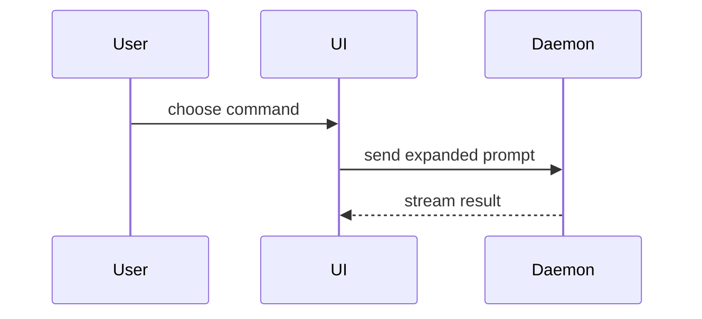

# PR Review

Pre-flight checklist for opening a pull request, and a structured framework for reviewing one. Pairs with `git-commit` (commit message quality) and the `code-reviewer` agent (line-level findings).

This skill owns PR workflow: diff scope, breaking-change analysis, coverage
delta, and reviewer briefing. Load relevant `sota-*` skills for domain-specific
checklists instead of copying those rules here.

## When to Use This Skill

- About to open a PR — sanity-check before pushing
- Reviewing someone else's PR — structured walkthrough
- Preparing PR description text
- Auditing a PR for breaking changes before merge to `main`

## When NOT to Use This Skill

- Trivial single-line PRs (typos, version bumps) — use judgment.
- Draft PRs intended only to share early ideas.

## Pre-PR Checklist

Run these checks in order before opening the PR:

### 1. Diff scope sanity

```bash
git fetch origin
git diff --stat origin/main...HEAD
git log --oneline origin/main..HEAD
```

Ask:
- Does the diff size match the stated goal?
- Are there unrelated changes (formatting, refactors) mixed in?
- Are there commits that should be squashed or split?

If unrelated changes are present → either split the PR or move them to a follow-up.

### 2. Breaking change scan

Look for:
- Public API signature changes (function args, return types, exported names)
- Schema migrations (DB, API contracts, config files)
- Renamed or deleted exports
- Default-value changes
- Behavioral changes that callers might depend on

```bash
# Grep for exported symbols changed
git diff origin/main...HEAD -- '*.ts' '*.py' | grep -E '^[-+](export|def |class )'
```

For every breaking change, the PR description must:
- Call it out under a **Breaking Changes** heading
- Include a migration note for callers

### 3. Test coverage delta

```bash
# Did tests change in proportion to code?
git diff --stat origin/main...HEAD | grep -E '(test|spec)'
```

Ask:
- Is there a test for every behavioral change?
- Is there a regression test for every bug fix?
- For new features: at least one happy-path and one error-path test.

If coverage didn't move with the code, justify it in the PR description.

### 4. Changelog / release notes

If the project keeps a CHANGELOG.md or release notes:
- User-visible change → add an entry now (don't defer).
- Use the `changelog-generator` skill to draft it.

### 5. Lint / type / test gates pass locally

Don't let CI tell you what `bun run ci` or `make check` could have told you 2 minutes ago.

Report each gate as **passed**, **failed**, **blocked**, or **not run** — never
"should pass". A gate you couldn't run locally is "not run", with the reason.

### 6. Self-review the diff

Read your own diff top to bottom. You'll catch 30% of issues yourself.

## PR Description Template

```markdown
## Summary

<smallest visual that makes the key point: pseudocode, call tree, file tree, diff sketch, or Mermaid>

## Evidence

- **Before:** <screenshot / output / failing test run>
  **After:** <screenshot / output / passing test run>
  (per claim: `command or procedure` → observed result: passed / failed / not run + reason)

## Breaking Changes
<none / list with migration notes>

## Merge Danger

**Door:** <one-way or two-way>

<optional: description>

**Blast Radius:** <one-word description>

<optional: potential ramifications of merge>

## Related
<issue links, design docs, prior PRs>

## Reviewer notes
<things you want the reviewer to look at carefully>
```

Skip preambles and keep prose brief. Use the project's domain vocabulary
(GLOSSARY.md, AGENTS.md or docs, if present). Keep the description scannable;
reviewers triage by skimming.

### Summary

Pick the smallest view that makes the key point clear, placed next to the short text
it supports. Keep only the calls, files, props, states, and boundaries the reader
needs. Use one visual or several; rarely all.

- **Logic or algorithm** → pseudocode:

```text
on(save)
  if content is unchanged
    return cached result
  write new content
  return fresh result
```

- **Runtime control flow** → call tree:

```text
submitForm
  createSession
    persistPrompt
    launchAgent
  navigateToSession
```

- **UI structure** → component tree, including state and module boundaries that matter.
- **File responsibility or a broad refactor** → shallow file tree:

```text
src/
├── commands/       # parses user actions
├── sessions/       # owns session state
└── transport/      # sends API requests
```

- **Component interaction or data flow** → Mermaid:



- **What changes, when the surrounding shape already exists** → a `diff` sketch in the shape of the topic (component tree, file layout, call tree, or control flow):

```diff
 on(save)
-  write content
+  if content is unchanged
+    return cached result
+  write new content
+  invalidate cache
```

- **Mostly new code, or order and ownership would be hidden by omitted context** → the whole block.

### Evidence

Concrete proof the change works, as a before and after. Screenshots are best when the
change is visual and the environment allows. Execution evidence is next: test results
and console output; show the exact test that now fails-then-passes, in pseudocode.

### Merge Danger

A **two-way door** can be walked back; a **one-way door** cannot. A PR that is cheap
to roll back is lower risk; destructive actions and hard-to-reverse decisions are
one-way doors. **Blast radius** is the scope of impact: layout shift, consumer
breakage, mobile responsiveness, and so on. Consider all of it.

## Reviewing Someone Else's PR

Review the changes since a fixed point along two axes:

- **Standards**: does the code follow this repo's documented coding standards?
- **Spec**: does the code match what the originating issue or spec asked for?

A change can pass one axis and fail the other, so each runs separately and neither
masks the other.

### 1. Pin the fixed point

Use the ref the user gave (commit, branch, tag, `main`, `HEAD~5`); ask if none. Capture
`git diff <fixed-point>...HEAD` (three-dot: against the merge-base) and
`git log <fixed-point>..HEAD --oneline`. Confirm `git rev-parse <fixed-point>` resolves
and the diff is non-empty. A bad ref or empty diff fails here, before any subagent starts.

### 2. Find the spec

In order: issue references in commit messages (`#123`, `Closes #45`); a path the user
passed; a spec file under `docs/`, `specs/`, or a plan directory matching the branch or
feature. If none is found, ask. If the user says there is none, skip the Spec pass and
say so in the report.

### 3. Find the standards sources

Search the repo for every file that documents how code is written. `CODING_STANDARDS.md`,
`CONTRIBUTING.md`, and `AGENTS.md` go on the list when present.

On top of the repo's documents, the Standards axis carries a **smell baseline**: twelve
Fowler code smells (*Refactoring*, ch. 3) that apply even when a repo documents nothing.
Smells are always judgement calls ("possible Feature Envy"), never hard violations. A
documented repo standard overrides the baseline: where it endorses something a smell
would flag, suppress the smell. Skip anything tooling already enforces.

- **Mysterious Name**: a name that doesn't reveal what it does or holds. → rename it; no honest name means the design is murky.
- **Duplicated Code**: the same logic shape in more than one hunk or file. → extract and share it.
- **Feature Envy**: a method that reaches into another object's data more than its own. → move it onto the data it envies.
- **Data Clumps**: the same few fields or params travel together. → bundle them into one type.
- **Primitive Obsession**: a primitive or string standing in for a domain concept. → give the concept its own small type.
- **Repeated Switches**: the same `switch`/`if` cascade on one type recurs. → polymorphism, or one shared map.
- **Shotgun Surgery**: one logical change forces scattered edits across many files. → gather what changes together.
- **Divergent Change**: one module edited for several unrelated reasons. → split by reason to change.
- **Speculative Generality**: abstraction, parameters, or hooks for needs the spec doesn't have. → delete; inline back.
- **Message Chains**: long `a.b().c().d()` navigation. → hide the walk behind one method.
- **Middle Man**: a class or function that mostly delegates onward. → cut it; call the target directly.
- **Refused Bequest**: a subclass that ignores or overrides most of what it inherits. → composition instead.

### 4. Pre-read

Skim the description, the file tree of changes, and the tests (they
state the behaviour being claimed). If scope looks wrong or the PR needs splitting,
raise that first rather than spending time on line-level findings.

### 5. Run both passes

Run **Standards** and **Spec** as two parallel, read-only `explore` subagents, each with
a fresh context. If subagents are not available, run them as two separate passes.

- **Standards brief:** give the diff command, the commit list, the standards files from step 3, and the smell baseline pasted in full. Ask for: (a) each place the diff breaks a documented standard, citing file and rule; (b) any baseline smell, named, with the hunk quoted. Distinguish hard violations (documented standards) from judgement calls (smells). Under 400 words.
- **Spec brief:** give the diff command, the commit list, and the spec text or path. Ask for: (a) requirements missing or partial; (b) behaviour not asked for (scope creep); (c) requirements that look implemented but look wrong. Quote the spec line for each finding. Under 400 words.

### 6. Report

Present `## Standards` and `## Spec`, verbatim or lightly cleaned. Do not merge or
rerank across axes. End with the finding count per axis and the worst issue *within
each axis*; never pick one winner across them. Use the `code-reviewer` agent when a
systematic line-level review is also wanted.

## Output Categories

When leaving review comments, label them:

| Label | Meaning |
|-------|---------|
| **blocking** | Must fix before merge |
| **non-blocking** | Should fix, but don't block on it |
| **nit** | Style/preference, take or leave |
| **question** | Asking for clarification, not requesting change |
| **praise** | Genuine — call out good work |

Mixing these labels makes intent clear and avoids "is this a request or just a thought?" ambiguity.

## Anti-Patterns

| Don't | Why |
|-------|-----|
| Bundle refactors with feature changes | Reviewers can't tell what's the feature vs the refactor |
| "LGTM" without reading | Wastes the request |
| Block on style preferences without a label | Frustrates author; use `nit:` |
| Demand tests after the fact when none existed before | Discuss as a separate effort |
| Approve and immediately request changes | Use one signal at a time |

## Quick Commands Reference

```bash
gh pr create --fill                 # use commits as PR body
gh pr create --web                  # open in browser
gh pr checkout <number>             # check out a PR locally
gh pr diff <number>                 # show diff
gh pr review <number> --comment -b "..."
gh pr review <number> --approve
gh pr review <number> --request-changes -b "..."
```
